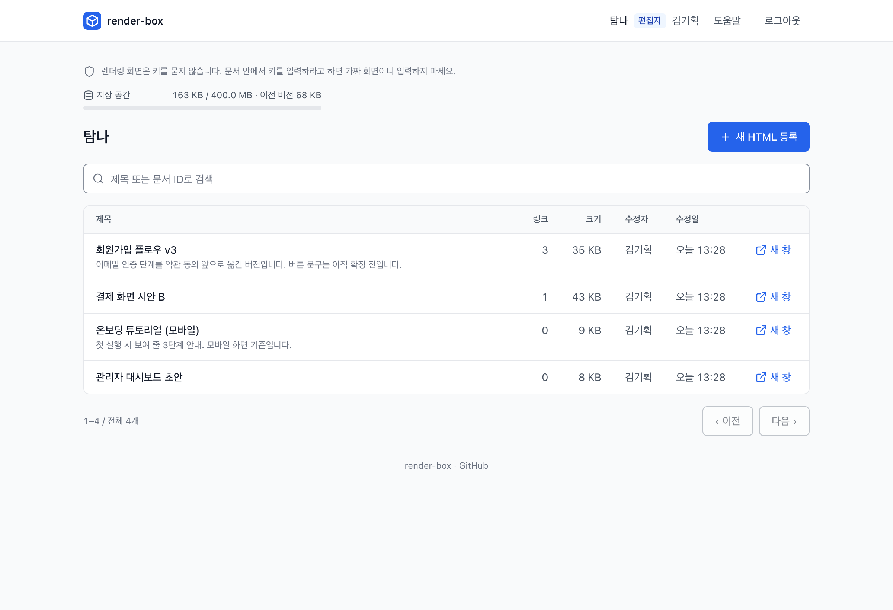
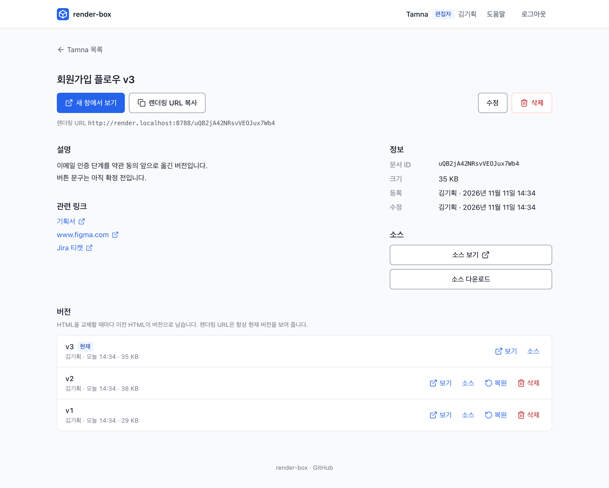

#  render-box

[](https://github.com/taeksoolee/render-box/actions/workflows/test.yml)
[](LICENSE)

> **English summary** — A self-hosted tool for sharing HTML prototypes by URL. Upload an HTML file (or let an AI
> agent upload it over MCP) and teammates open it in a new tab after logging in with a personal access key.
> Uploaded HTML runs on a separate render host under a sandboxed CSP, isolated from the admin UI. Replacing the
> HTML keeps the old one as a version; total storage is capped and nothing is pruned behind your back.
> Runs on the Cloudflare Workers free plan with D1 (Hono, HTMX, Drizzle). UI and docs are in Korean.
> Deploy your own: `pnpm setup:remote`.

AI로 만든 HTML 프로토타입을 메신저로 주고받는 대신, 파일을 올리면 주소가 하나 생기고 받은 사람이 새 창에서 실제 동작을 확인하는 도구입니다.

내 Cloudflare 계정에 직접 배포해서 씁니다. 무료 플랜으로 충분하고, 올린 HTML은 외부 서비스로 나가지 않습니다.

<p>
  
  
</p>

## 기능

- **올리면 바로 주소** — 파일을 끌어다 놓거나 코드를 붙여 넣고 저장하면 렌더링 URL이 나옵니다. 10MB까지.
  EUC-KR 파일은 UTF-8로 바꾸고, 같은 폴더의 이미지는 골라서 HTML 안에 넣습니다.
- **주소는 그대로, 내용은 최신** — HTML을 교체해도 이미 공유한 주소로 최신본이 열립니다.
- **버전** — 교체할 때마다 이전 HTML이 남습니다. 이전 버전 보기·소스·복원·삭제.
- **저장 공간 상한** — 전체 사용량을 보여 주고, 상한(기본 400MB)을 넘으면 업로드를 막습니다.
  오래된 버전을 몰래 지우지 않습니다. 정리 화면에서 지웠을 때 공간이 많이 생기는 순서로 골라 지웁니다.
- **AI 도구에서 바로 올리기 (MCP)** — Claude Code에서 "render-box에 올려 줘"라고 하면 올리고 주소를 알려 줍니다.
- **스크립트·CI (REST API)** — `curl`로 올리기·교체·조회.
- **프로젝트** — 문서는 프로젝트(예: `tamna`)에 속하고, 키는 프로젝트마다 편집자/열람자 역할을 받습니다.
  속하지 않은 프로젝트의 문서는 주소를 알아도 열리지 않습니다. 모든 프로젝트를 관리하는 관리자 키도 둘 수 있습니다.
- **개인 접근 키** — 사람마다 다른 키로 로그인합니다. 키를 회수하면 그 키의 모든 세션이 바로 끊깁니다.

## 격리

올린 HTML은 신뢰하지 않습니다. 내용을 걸러내지 않고 그대로 실행하되, 관리 화면을 건드리지 못하게 막습니다.

- 관리 화면과 렌더링 화면은 **다른 주소(출처)** 입니다. 세션 쿠키도 따로입니다.
- 렌더링 응답에 `Content-Security-Policy: sandbox`를 붙여, 문서가 고유하지 않은 출처(opaque origin)에서 실행됩니다.
- 관리 화면은 Fetch Metadata로 다른 사이트·sandbox 문서에서 온 하위 요청을 거절합니다.
- 셋 중 하나가 뚫려도 관리 화면이 안전하도록 겹쳐 둡니다. 자세한 위협 모델은 [design.md](docs/design.md) 2·5장에 있습니다.

## 직접 배포하기

Cloudflare 계정(무료 플랜)과 Node.js 24, pnpm이 필요합니다.

```sh
git clone https://github.com/taeksoolee/render-box.git && cd render-box
nvm use && pnpm install
pnpm --filter @render-box/admin exec wrangler login
pnpm setup:remote
pnpm project create <slug> --name <이름> --remote          # 예: tamna --name Tamna
pnpm key create --remote --name <이름> --project <slug> --role EDITOR
```

속한 프로젝트가 없는 키로 로그인하면, 관리자에게 보낼 키 앞자리와 `project grant` 명령을 보여 주는 안내 화면이 나옵니다.

`pnpm setup:remote`가 다음을 한 번에 합니다. 다시 실행해도 이미 있는 것은 그대로 씁니다.

1. 로그인한 계정 확인 (계정이 여러 개면 `--account <id>`)
2. D1 데이터베이스 `render-box` 찾기 또는 만들기
3. workers.dev 주소 확인 (처음 배포한 Worker 주소에서 알아냄, 또는 `--subdomain <이름>`)
4. `HANDOFF_SECRET`을 렌더링·관리 Worker에 같은 값으로 등록
5. 마이그레이션 → 배포(render → admin → api) → 보안 헤더 점검

배포 설정은 `render-box.deploy.json`(저장소에 올라가지 않음)에 저장되고, 이후에는 이렇게 씁니다.

| 명령 | 설명 |
| --- | --- |
| `pnpm db:migrate:remote` → `pnpm deploy:prod` → `pnpm check:headers` | 업데이트 배포와 점검. 새 마이그레이션이 있으면 반드시 먼저 |
| (배포 스크립트·마이그레이션을 바꿨을 때) | 같은 계정에 `--env staging`으로 만들었다 지우는 배포 시험: [design.md 10.7](docs/design.md) |
| `pnpm measure` (`RB_KEY=…`이면 로그인 화면도) | 운영 응답 시간과 Cloudflare 실행 위치(`cf-placement`) 측정 |
| `pnpm key create --remote --name <이름> --project <slug> --role EDITOR\|VIEWER` | 키 발급. 키 원문은 이때 한 번만 보입니다. AI 도구(MCP)용 키는 로그인 키와 따로 발급하길 권합니다 (`--name 홍길동-mcp`) |
| `pnpm key list --remote` / `revoke <prefix> --remote` | 키 목록(관리자 여부, 속한 프로젝트와 역할)·회수 |
| `pnpm key create --remote --name <이름> --admin` / `pnpm key admin <prefix> on\|off --remote` | **관리자 키**: 멤버십 없이 모든 프로젝트(새로 만든 것 포함)의 문서를 관리합니다. 키·프로젝트 관리는 관리자도 CLI로만 합니다. 꼭 필요한 사람에게만 주세요 |
| `pnpm project create <slug> --name <이름> --remote` | 프로젝트 만들기 (예: `tamna --name Tamna`) |
| `pnpm project grant <prefix> <slug> --role EDITOR\|VIEWER --remote` | 키를 프로젝트에 넣거나 역할 바꾸기. `revoke <prefix> <slug>`로 빼기 |
| `pnpm project list` / `members <slug>` / `rename <slug> --name …` / `move <문서 키> <slug>` (`--remote`) | 프로젝트 목록·멤버·이름 바꾸기·문서 옮기기 |
| `pnpm project delete <slug> --remote` | 프로젝트 지우기. 문서가 하나도 없을 때만 되고, 멤버 연결도 함께 지웁니다 |

**같은 계정에 환경 더 두기:** 모든 원격 명령에 `--env <이름>`을 붙이면 Worker(`render-box-<이름>-admin` 등)와 D1(`render-box-<이름>`), 설정 파일(`render-box.<이름>.deploy.json`)이 따로 생겨 기존 배포를 건드리지 않습니다. `RB_ENV=<이름>`도 같습니다.

```sh
pnpm setup:remote --env staging
pnpm project create demo --name Demo --remote --env staging
pnpm key create --remote --env staging --name 테스트 --project demo --role EDITOR
pnpm deploy:prod --env staging
pnpm teardown:remote --env staging --yes      # 그 환경의 Worker·D1(문서 전부)·설정 파일 삭제. 기본 환경은 지우지 않음
```

`render-box.deploy.json`에서 바꿀 수 있는 값:

| 키 | 기본값 | 설명 |
| --- | --- | --- |
| `storageLimitMb` | `400` | HTML 전체 용량 상한. 무료 D1 한도(500MB)보다 낮게 둡니다. 유료 플랜이면 올려도 됩니다 |
| `storageWarnPercent` | `80` | 목록에 경고를 띄우는 사용률 |
| `helpUrl` | 이 저장소의 [사용 안내](docs/guide.md) | 관리 화면 "도움말" 링크. 팀 안내 페이지로 바꾸거나 `""`로 숨김 |
| `defaultProject` | (없음) | 관리 화면이 처음 여는 프로젝트 slug (예: `tamna`). 마지막으로 본 프로젝트가 있으면 그쪽이 먼저고, 그 프로젝트 멤버가 아니면 이름순 첫 프로젝트 |
| `origins` | workers.dev 주소 | 자체 도메인을 쓰면 Cloudflare 대시보드에서 각 Worker에 도메인을 연결한 뒤 `{ "app", "render", "api" }`를 직접 적습니다. 관리와 렌더링은 반드시 다른 호스트여야 합니다 |

바꾼 뒤 `pnpm deploy:prod`로 다시 배포하면 반영됩니다.

### AI에게 맡기기

배포 절차는 [docs/design.md](docs/design.md)(9.3 배포, 10.7 배포 시험)에 있어서, 저장소를 받은 뒤 Claude Code 같은 AI 도구에 이렇게 말하면 됩니다.

| 하려는 일 | 이렇게 말하세요 |
| --- | --- |
| 처음 배포 | "design.md 내용 참고해서 배포해 줘" |
| 업데이트 배포 | "design.md 내용 참고해서 업데이트 배포해 줘" (새 마이그레이션이 있으면 먼저 적용합니다) |
| 배포 스크립트를 바꾼 뒤 확인 | "design.md 내용 참고해서 배포 시험해 줘" (같은 계정에 `--env staging`으로 만들었다 지웁니다) |

사람이 해야 하는 일은 두 가지입니다: Cloudflare 로그인 승인(`wrangler login`, 브라우저)과, `pnpm key create`가 한 번만 보여 주는 키 받기. 운영에 실제로 반영되는 명령은 AI가 대신 실행하지 않고 실행할 명령을 알려 주게 해 두면 안전합니다.

## 사용 안내

- [사용 안내 (docs/guide.md)](docs/guide.md) — 로그인, 올리기, 공유, 버전, 저장 공간. 관리 화면의 **도움말**이 이 문서로 연결됩니다.
- [AI·스크립트로 올리기 (docs/api.md)](docs/api.md) — MCP 연결, REST API, 오류 코드

```sh
claude mcp add --transport http render-box https://render-box-api.<계정>.workers.dev/mcp \
  --header "Authorization: Bearer rb_..."
```

## 로컬 개발

Cloudflare 계정 없이 로컬 D1로 돌아갑니다.

```sh
nvm use && pnpm install
pnpm setup:local        # .dev.vars 생성(공유 HANDOFF_SECRET) + 로컬 D1 마이그레이션
pnpm key create --name 김기획 --project default --role EDITOR
pnpm key create --name 박개발 --project default --role VIEWER
pnpm dev                # 렌더링 :8788 → 관리 :8787 → API :8789 순서로 실행
```

`*.localhost` 주소는 Chrome·Firefox에서 바로 열립니다. 발급된 키로 http://app.localhost:8787 에 로그인하세요.

| 명령 | 설명 |
| --- | --- |
| `pnpm test` | 단위 테스트 (Vitest). 버전·저장 공간 SQL은 실제 마이그레이션을 Node 내장 SQLite에 적용해 검사 |
| `pnpm typecheck` | 타입 검사 |
| `pnpm check:prod-mode` | 관리·렌더링 Worker를 `DEV_MODE` 없이 로컬에서 띄워 운영에서만 도는 경로(해시 정적 파일, HSTS, https 전용 CSP)를 확인. CI에서도 돕니다 |
| `RB_EDITOR_KEY=… RB_VIEWER_KEY=… pnpm test:e2e` | 브라우저 테스트: Chromium·Firefox·WebKit. `pnpm dev` 실행 중이어야 하고, 처음 한 번 `pnpm exec playwright install chromium firefox webkit` |
| `RB_EDITOR_KEY=… pnpm screenshots` | README 스크린샷 다시 찍기 (새 로컬 상태에서) |

브라우저 테스트는 한 번에 하나씩 실행합니다. 로컬에서는 여러 Worker가 같은 SQLite 파일을 함께 쓰므로, 병렬로 돌리면 D1이 간헐적으로 `Failed to get session commit token` 오류를 냅니다. 운영 D1에는 해당하지 않습니다.

```
apps/admin          관리 화면 Worker (로그인, 문서 등록·관리, 버전, 저장 공간)
apps/render         렌더링 전용 Worker (올린 HTML을 격리해서 실행)
apps/api            키로 쓰는 API Worker: MCP(AI가 직접 올리기) + REST(스크립트·CI)
packages/db         DB 스키마, 마이그레이션, 청크 저장
packages/auth       키·세션·핸드오프, 로그인 실패 제한
packages/documents  문서 검증·업로드·조회·버전·저장 공간 (admin과 api가 공유)
packages/shared     공통 미들웨어와 유틸
scripts/            배포·키 관리 CLI, 점검 스크립트
docs/               사용 안내와 설계 문서
```

## 설계 문서

| 문서 | 내용 |
| --- | --- |
| [docs/prd.md](docs/prd.md) | 목적, 사용 흐름, 로드맵, 화면, 완료 기준 |
| [docs/design.md](docs/design.md) | 시스템 구성, 인증, 렌더링 격리, DB, 라우팅, 테스트 계획 |
| [docs/ui.md](docs/ui.md) | UI 디자인 가이드 (토큰, 레이아웃, 컴포넌트, 문구) |
| [docs/decisions.md](docs/decisions.md) | 주요 결정과 기각한 대안 |

설계를 바꾸려면 먼저 [docs/decisions.md](docs/decisions.md)에서 해당 결정의 기각 이유를 확인하세요.

## 라이선스

[MIT](LICENSE)
