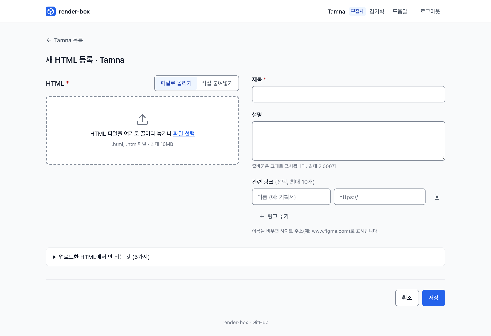

# render-box 사용 안내

HTML 파일을 올리면 주소가 하나 생기고, 그 주소를 받은 팀원이 새 창에서 실제 동작을 확인하는 도구입니다. 관리 화면 오른쪽 위 **도움말**에서 이 문서를 열 수 있습니다.

- 직접 배포해서 운영하려면 [README](../README.md#직접-배포하기)를 보세요.
- AI 도구·스크립트 연결의 자세한 내용은 [api.md](api.md)에 있습니다.

## 프로젝트와 역할

접근 키는 사람마다 다르고, 운영자가 발급합니다. 문서는 **프로젝트**(예: `tamna`)에 속하고, 키는 프로젝트마다 역할을 받습니다. 예를 들어 Tamna에서는 편집자, 다른 프로젝트에서는 열람자일 수 있습니다.

- 오른쪽 위에 지금 프로젝트와 그 프로젝트에서의 내 역할이 보입니다. 프로젝트가 여럿이면 이름을 눌러 바꿉니다.
- 속하지 않은 프로젝트의 문서는 목록에 없고, 주소를 받아도 열리지 않습니다. 필요하면 운영자에게 프로젝트에 넣어 달라고 요청하세요.

| 역할 | 할 수 있는 것 (그 프로젝트 안에서) |
| --- | --- |
| 편집자 (EDITOR) | 올리기, 정보 수정, HTML 교체, 버전 복원·삭제, 문서 삭제, 보기 |
| 열람자 (VIEWER) | 목록, 상세, 렌더링, 소스 보기·다운로드 |
| 관리자 | 모든 프로젝트에서 편집자와 같습니다. 프로젝트에 따로 넣지 않아도 새 프로젝트까지 보입니다. 상단 바에 "관리자"로 표시됩니다 |

키 발급, 프로젝트 만들기, 멤버 넣기·빼기, 관리자 지정은 관리자도 화면에서 할 수 없고 운영자가 명령줄로 합니다.

## 로그인

1. 운영자에게 받은 주소(관리 화면)를 엽니다.
2. **접근 키**를 넣고 로그인합니다. 한 번 로그인하면 30일 동안 유지됩니다. 비밀번호 관리자에 저장해도 됩니다.
3. 팀원이 보낸 렌더링 주소를 처음 열 때도 이 로그인 화면이 나옵니다. 로그인하면 바로 문서가 열립니다.

> **렌더링 화면은 키를 묻지 않습니다.** 문서 안에서 키를 입력하라고 하면, 누군가 올린 HTML이 만든 가짜 화면이니 입력하지 마세요.

## HTML 올리기 (편집자)



1. 올릴 프로젝트를 고르고, 목록에서 **새 HTML 등록**을 누릅니다. 문서는 지금 프로젝트에 올라갑니다.
2. HTML 파일을 끌어다 놓거나, **직접 붙여넣기**로 코드를 붙여 넣습니다. 최대 10MB입니다.
   - EUC-KR 파일은 UTF-8로 바꿔 줍니다.
   - HTML이 같은 폴더의 이미지를 쓰면, 저장할 때 이미지 파일을 고르라고 합니다. 고른 이미지는 HTML 안에 들어갑니다. 고르지 않은 이미지는 빈 상자로 보입니다.
   - 동작하지 않을 리소스(같은 폴더의 스크립트·스타일 파일 등)가 있으면 경고를 보여 줍니다. 저장은 할 수 있습니다.
3. 제목을 확인하고(파일의 `<title>`로 자동으로 채워집니다), 필요하면 설명과 관련 링크를 넣습니다. 관련 링크는 넣지 않아도 됩니다.
4. **저장**하면 렌더링 주소가 나옵니다. **렌더링 URL 복사**를 눌러 메신저로 보내면 됩니다.

### 올린 HTML에서 안 되는 것

- 함께 있던 스크립트·스타일 파일은 올라가지 않습니다. 이미지는 저장할 때 파일을 고르면 HTML 안에 넣어 줍니다.
- 브라우저 저장소(`localStorage` 등)는 새로고침하면 초기화됩니다.
- 새 창 열기(`window.open`, `target="_blank"`)와 파일 다운로드는 동작하지 않습니다.
- 외부 API는 모든 출처를 허용하는 공개 API(`Access-Control-Allow-Origin: *`)만 부를 수 있습니다.
- 주소를 바꾸는 페이지 이동(`history.pushState`)을 쓰면 새로고침할 때 문서를 찾지 못합니다. 해시(`#/page`) 방식을 쓰세요.

올린 HTML은 관리 화면과 분리된 주소에서 격리되어 실행됩니다. 그래서 위 기능이 막혀 있습니다.

## 보기와 공유

- 목록에서 제목으로 찾거나, 문서 ID 앞부분으로 찾을 수 있습니다.
- 상세 화면에서 **새 창에서 보기**, **렌더링 URL 복사**, **소스 보기**, **소스 다운로드**를 할 수 있습니다.
- 렌더링 주소도 로그인한 사람만 열 수 있습니다. 주소를 받은 사람에게도 키가 있어야 합니다.

## 고치기 (편집자)

상세 화면의 **수정**에서 제목·설명·링크를 고치거나 **HTML을 교체**합니다.

- HTML을 교체해도 **렌더링 주소는 그대로**입니다. 이미 공유한 주소로 최신 내용을 볼 수 있습니다.
- 다른 사람이 먼저 저장했다면 덮어쓰지 않고 알려 줍니다. 입력한 내용은 남아 있으니 확인하고 다시 저장하세요.

## 버전

HTML을 교체할 때마다 이전 HTML이 **버전**으로 남습니다. 상세 화면 아래 **버전**에서 봅니다.

- **보기 / 소스:** 이전 버전을 새 창에서 보거나 코드를 봅니다.
- **복원 (편집자):** 고른 버전의 HTML이 새 버전으로 추가되고, 렌더링 주소에서 그 내용이 보입니다. 지금 HTML도 이전 버전으로 남습니다.
- **삭제 (편집자):** 이전 버전을 지웁니다. 되돌릴 수 없습니다. 현재 버전은 지울 수 없습니다.
- 제목·설명·링크만 고치면 버전이 생기지 않습니다.

## 저장 공간

목록 위에 전체 사용량(예: `123 MB / 400 MB`)이 보입니다.

- 80%를 넘으면 경고가 뜹니다. **가득 차면 새로 올리기와 HTML 교체가 막힙니다.** 오래된 버전을 자동으로 지우지 않습니다.
- 사용량을 누르면 **저장 공간** 화면이 열립니다. 이전 버전이 지웠을 때 공간이 많이 생기는 순서로 나오니, 필요 없는 것을 골라 한 번에 지우세요 (편집자).
- 다른 버전과 같은 HTML을 쓰는 버전(복원으로 생긴 경우)은 지워도 공간이 늘지 않는다고 표시됩니다.
- 안 쓰는 문서를 삭제해도 공간이 생깁니다. 문서를 삭제하면 그 문서의 모든 버전이 함께 지워집니다.

## AI 도구로 올리기

Claude Code 같은 AI 도구에서 "render-box에 올려 줘"라고 말해 HTML을 바로 올리고 렌더링 주소를 받을 수 있습니다 (MCP). 로그인에 쓰는 접근 키를 그대로 씁니다.

```sh
claude mcp add --transport http render-box https://<API 주소>/mcp \
  --header "Authorization: Bearer rb_..."
```

- API 주소는 운영자에게 물어보세요. 보통 관리 화면 주소의 `admin`을 `api`로 바꾼 주소입니다.
- 이렇게 말하면 됩니다: "회원가입 화면 HTML 만들어서 render-box에 올려 줘", "방금 문서에서 버튼 색만 바꿔서 업데이트해 줘"
- 편집할 수 있는 프로젝트가 여럿이면 "tamna 프로젝트에 올려 줘"처럼 프로젝트를 말해 주세요.
- AI로는 1MB까지 올릴 수 있고, 삭제는 할 수 없습니다. 이미지는 HTML 안에 넣거나 `https://` 주소를 써야 합니다.

자세한 내용: [api.md — AI 도구에서 올리기](api.md#1-ai-도구에서-올리기-mcp)

## 스크립트로 올리기

curl이나 CI에서 `POST /api/v1/html`로 올립니다 (10MB까지). 사용법과 오류 코드는 [api.md — 스크립트에서 올리기](api.md#2-스크립트에서-올리기-rest-api)에 있습니다.

```sh
curl -X POST "https://<API 주소>/api/v1/html" --url-query "title=회원가입 화면" \
  -H "Authorization: Bearer rb_..." -H "Content-Type: text/html" --data-binary @signup.html
```

## 자주 묻는 질문

**"아직 속한 프로젝트가 없습니다"가 떠요.**
키가 아직 어느 프로젝트에도 들어가 있지 않습니다. 화면의 키 앞자리와 명령을 복사해 관리자에게 보내세요. 관리자가 넣어 주면 새로 고침만 하면 됩니다.

**키를 잃어버렸거나 유출된 것 같아요.**
운영자에게 회수와 재발급을 요청하세요. 회수하면 그 키로 로그인된 모든 화면이 바로 로그아웃됩니다.

**올린 화면이 깨져 보여요.**
[올린 HTML에서 안 되는 것](#올린-html에서-안-되는-것)을 확인하세요. 경고가 떴다면 그 경로를 AI에게 그대로 알려 주고 고쳐 달라고 하면 됩니다.

**"저장 공간이 부족합니다"가 떠요.**
[저장 공간](#저장-공간) 화면에서 이전 버전이나 안 쓰는 문서를 지운 뒤 다시 저장하세요.

**AI 도구 연결이 안 돼요.**
키가 맞는지, 주소 끝이 `/mcp`인지 확인하세요. 조직의 보안 프로그램이 통신을 막을 수도 있습니다. 이때는 보안 정책을 우회하지 말고 관리 담당자에게 문의하세요.
